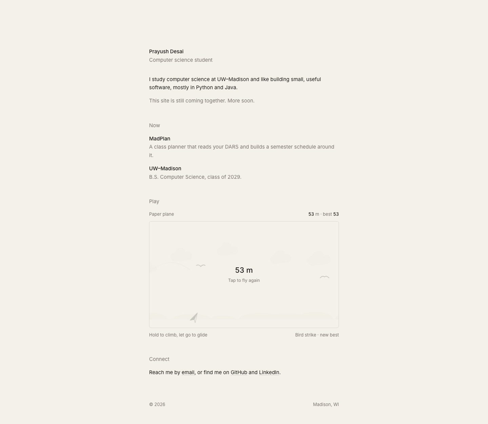

<div align="center">
  <a href="https://prayushdesai.com">
    
  </a>
  <h1>prayushdesai.com</h1>
  <p>
    Source for my personal website. A single page of hand-written HTML and CSS,<br>
    hosted on <a href="https://pages.github.com">GitHub Pages</a>.
  </p>
  <p>
    <a href="https://prayushdesai.com"><strong>Visit the site →</strong></a>
  </p>
</div>

<br>

<a href="https://prayushdesai.com">
  
</a>

## Status

The full version — projects, write-ups and a résumé — is in progress. For now the homepage is a single landing page with my links.

## Stack

- **Markup & styles:** plain HTML and CSS, nothing to build
- **Game:** *Paper plane*, a tiny one-button flyer. Hold to climb, let go to glide, and steer around birds and red balloons. Drawn on a `<canvas>` in vanilla JavaScript.
- **Type:** [Inter](https://rsms.me/inter/), one typeface for everything
- **Palette:** one warm paper tone, near-black ink, and UW red for hover states
- **Hosting:** GitHub Pages
- **Domain & DNS:** Cloudflare

## Structure

```
.
├── index.html      # the whole homepage: markup, styles and the game
├── 404.html        # served by GitHub Pages for unknown paths
├── favicon.svg
├── assets/         # social preview image and README screenshot
├── robots.txt
├── sitemap.xml
└── CNAME           # points GitHub Pages at prayushdesai.com
```

## Running locally

There's no build step. Clone it and open the file, or serve the folder so the root-relative paths resolve:

```sh
git clone https://github.com/prayush27/prayushdesai.com.git
cd prayushdesai.com
python3 -m http.server 8000
```

Then go to [localhost:8000](http://localhost:8000).

## Using this code

You're welcome to borrow from it. The code is MIT-licensed, so take what's useful. If you base your own site on the design, a link back to [prayushdesai.com](https://prayushdesai.com) would be appreciated. Please don't publish my name, photos or writing as your own.

## Contact

[pdesai25@wisc.edu](mailto:pdesai25@wisc.edu) · [LinkedIn](https://linkedin.com/in/prayushdesai)
